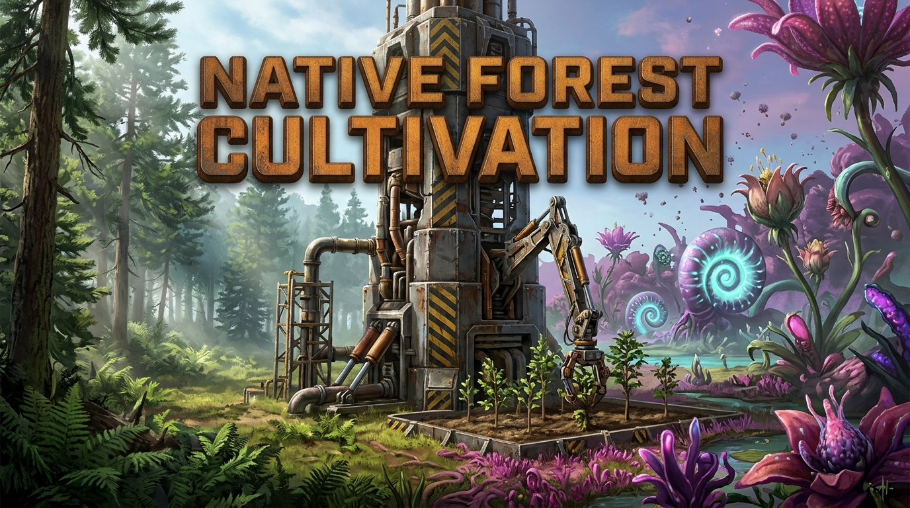

# Native Forest Cultivation

Factorio 2.1 + Space Age mod. Cultivate planet- and soil-appropriate native vegetation using standard Agricultural Towers and vanilla tree seeds, while living trees actively reduce local airborne pollutants.

A fork of [FreezingSnail/native-flora-cultivation](https://github.com/FreezingSnail/native-flora-cultivation).

---

## Key Features

1. **Unified Tree Seed**:
   - Both Nauvis and Gleba agricultural towers accept the single standard vanilla `tree-seed`.
   - No need for specialized planet-specific seeds or biochamber intermediate recipes to start planting.

2. **Native Flora & Soil-Specific Growth**:
   - **Nauvis**: Towers and manual planting grow native Nauvis trees (`tree-plant`) on standard soils (grass, dirt, sand).
   - **Gleba**: Planting a `tree-seed` on Gleba fertile soils automatically sprouts native Gleba species tailored to the specific ground:
     - `natural-yumako-soil` / `artificial-yumako-soil` / wetland tentacles → **Cuttlepop**
     - `natural-jellynut-soil` / `artificial-jellynut-soil` / wetland slime → **Teflilly**
     - Lowland cauliflower cream (`lowland-cream-cauliflower`) → **Slipstack**
     - Lowland red veins (`lowland-red-vein`) → **Funneltrunk**
     - Lowland olive blubber (`lowland-olive-blubber`) → **Hairy clubnub**
     - Lowland brown blubber & red infection → **Lickmaw**
     - Lowland cream red & pale green → **Boompuff**
     - Midland cracked lichen → **Stingfrond**
     - Midland yellow crust & turquoise bark → **Sunnycomb**
     - Lowland & wetland dead skins → **Water cane**
   - **Surface Isolation**: Nauvis trees never spawn or grow on Gleba; Gleba flora never spawn or grow on Nauvis. Unsupported tiles (e.g., bare rock, concrete, space platform, deep water) reject planting.

3. **Space Age Wood Loop & Sustainable Cultivation**:
   - Following Space Age vanilla agricultural design, harvested crops yield their native products (such as spoilage, stone, or wood) plus at least **4 Wood** (some naturally yielding up to 5 or 6 wood, and Slipstack yielding 4 stone; no free tree-seeds dropped directly).
   - The standard `tree-seed` recipe (`2 wood → 1 tree-seed`) has its surface condition expanded to permit crafting on Gleba as well as Nauvis.
   - Processing harvested wood in assemblers, biochambers, or player crafting sustains the replanting loop cleanly (4 wood yields 2 tree-seeds, a 2x surplus).
   - Wild flora and immature sprouts do not drop vanilla tree-seeds, preventing unintended seed duplication during tower clearing and planting cycles.

4. **Verifiable Environmental Absorption**:
   - **Nauvis**: Living wild trees and cultivated `tree-plant` absorb airborne **pollution** at `-0.005/sec`.
   - **Gleba**: Living wild flora and cultivated crops absorb airborne **spores** at `-0.05/sec` and pollution at `-0.005/sec`.
   - **Operating Cycle Net Positive**: Empirical in-engine measurements verify that even accounting for agricultural tower power draw and spore emissions (4 spores/min), an active agricultural tower grove achieves strong positive net pollutant reduction compared to empty land.

5. **Streamlined Factorio Space Age Integration**:
   - Clean architecture using only the vanilla `tree-seed` and vanilla recipes.
   - No custom seed inventory clutter, redundant biochamber recipes, or auxiliary menu categories.
   - Clean mod load and uninstallation footprint.

---

## Flora Overview

| Flora Species | Native Soil / Biome | Harvest Output |
| :--- | :--- | :--- |
| **Cuttlepop** | Yumako soils, wetland tentacles | 8 Spoilage, 4 Wood |
| **Slipstack** | Lowland cauliflower cream | 6 Spoilage, 4 Stone, 4 Wood |
| **Funneltrunk** | Lowland red veins | 4 Spoilage, 6 Wood |
| **Hairy clubnub** | Lowland olive blubber | 5 Spoilage, 5 Wood |
| **Teflilly** | Jellynut soils, wetland slime | 5 Spoilage, 5 Wood |
| **Lickmaw** | Lowland brown blubber, red infection | 10 Spoilage, 4 Wood |
| **Stingfrond** | Midland cracked lichen | 8 Spoilage, 4 Wood |
| **Boompuff** | Lowland cream red, pale green | 6 Spoilage, 4 Wood |
| **Sunnycomb** | Midland yellow crust, turquoise bark | 10 Spoilage, 4 Wood |
| **Water cane** | Lowland & wetland dead skins | 4 Wood |
| **Nauvis Trees (01–09)** | Nauvis grass / dirt / sand | 4 Wood |

---

## Requirements

- **Factorio**: 2.1+
- **Expansion**: Space Age

---

## Installation

1. Place the mod folder or packaged ZIP `native-forest-cultivation_1.1.0.zip` into your Factorio `mods` directory (`%APPDATA%\Factorio\mods` on Windows).
2. Enable **Native Forest Cultivation** in the in-game Mod Manager.
3. Load any new or existing save; existing upstream 1.0.3 saves are supported seamlessly.

---

## Credits and Attribution

- Originally created by **FreezingSnail** as *Native Flora Cultivation* ([GitHub: FreezingSnail/native-flora-cultivation](https://github.com/FreezingSnail/native-flora-cultivation)).
- Released under the [MIT License](LICENSE).
